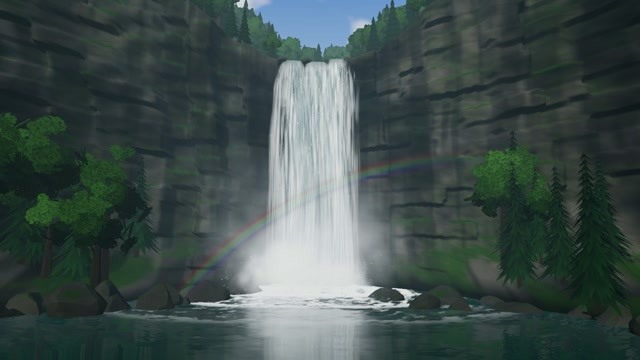
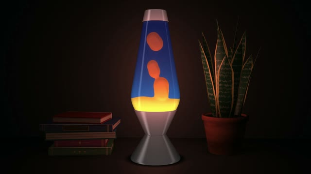
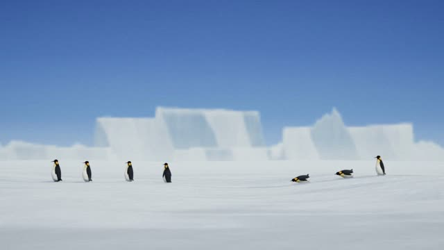
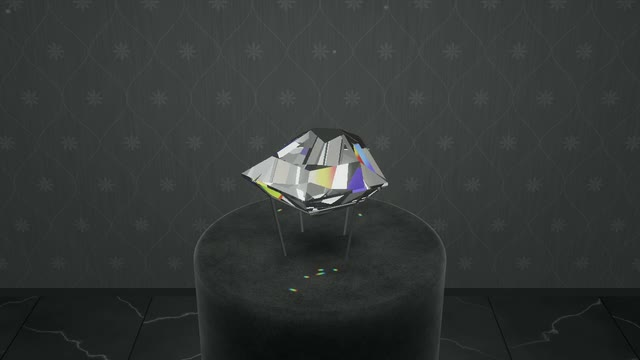
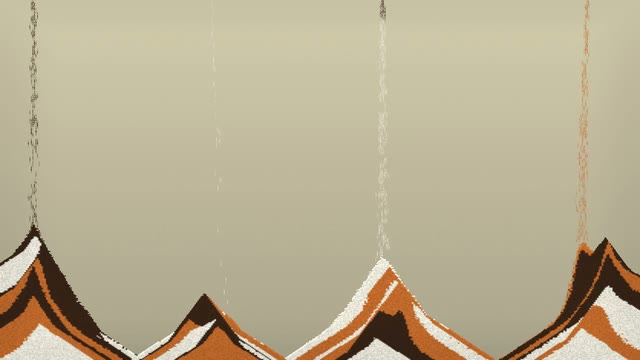
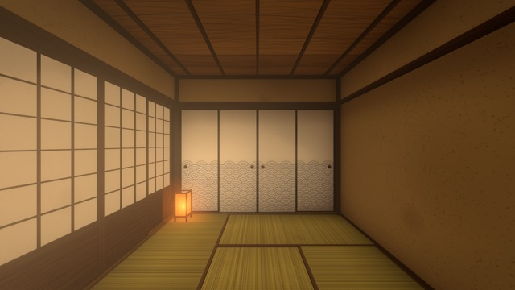
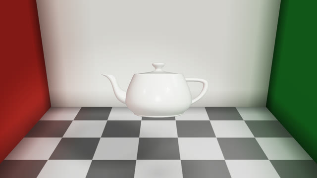

# vibe-screensaver — Web スクリーンセーバ集

Webブラウザで動く、スクリーンセーバ風のアニメーション集です。

**▶ ブラウザですぐに見る: https://yohhoy.github.io/vibe-screensaver/**

## 動かし方

WebGL2 対応のブラウザとインターネット接続が必要です。スマホでは、表示中は画面が自動で消えません（対応ブラウザのみ）。

共通の操作は次のとおりです。スマホでは、画面をタップすると操作ガイドが表示されます。

- **シーン切替**: Space / 左右スワイプ
- **強度**: ↑ / ↓ / 上下スワイプ
- **全画面**: F / ダブルクリック
- **作品一覧へ戻る**: Esc / 「← 一覧」

## [3D パイプ](https://yohhoy.github.io/vibe-screensaver/pipes.html)

3D 空間に、色とりどりのパイプが自動で伸びていきます。

シーン切替: リセット / 強度: 速度 / J: ジョイントを球 ⇔ エルボーで切り替え

## [チューブトンネル](https://yohhoy.github.io/vibe-screensaver/tube.html)

ネオングリッドのチューブの中を、どこまでも飛び続けます。

シーン切替: 新しいコースと配色 / 強度: 速度

隠し要素（ネタバレ注意）

ときどき壁のハッチから Claude Code のマスコットが跳び出してきます。**C** キーですぐに呼び出せます。

## [ナイトドローン](https://yohhoy.github.io/vibe-screensaver/drone.html)

夜の街を、紙飛行機形のドローンが輪をくぐりながら飛び続けます。

シーン切替: 次のコース / 強度: 速度

## [雨の水面](https://yohhoy.github.io/vibe-screensaver/ripple.html)

静かな水面に雨が降り、波紋がゆるやかに広がっては消えていきます。

シーン切替: 次の景色 / 強度: 雨の強さ

隠し要素（ネタバレ注意）

景色ごとに、ときどき出来事が起こります。Moon では流れ星が流れ、City では UFO が現れ、Mist では魚が跳ねます。**C** キーで、いまの景色の出来事をすぐに起こせます。

## [焚き火](https://yohhoy.github.io/vibe-screensaver/campfire.html)

夜の森の焚き火。炎が揺らぎ、火の粉が星空へ舞い上がります。

シーン切替: なし / 強度: 火の強さ

隠し要素（ネタバレ注意）

ときどきリスが走ってきて、どんぐりを焚き火に投げ込むと打ち上げ花火が上がります。**C** キーですぐに呼び出せます。

## [クラゲ水槽](https://yohhoy.github.io/vibe-screensaver/jellyfish.html)

薄暗い水族館の大きな水槽。光る線で描いたクラゲが、水流に乗ってゆっくり回ります。

シーン切替: リセット / 強度: 泡の筋の数

## [オーロラ](https://yohhoy.github.io/vibe-screensaver/aurora.html)

山あいの谷から見上げる北の空に、オーロラのカーテンが揺らめきます。ときどき急に明るく激しくなります。

シーン切替: リセット / 強度: オーロラの帯の数

隠し要素（ネタバレ注意）

ときどきサンタクロースのシルエットが空を横切ります。**C** キーですぐに呼び出せます。

## [滝](https://yohhoy.github.io/vibe-screensaver/waterfall.html)

深い森の大きな滝。白い水が流れ落ち、滝壺から霧が立ちのぼります。

シーン切替: 次の景色 / 強度: 水量

隠し要素（ネタバレ注意）

ときどき、鯉が滝を登り、そのあと龍が空へ昇ります（登竜門）。**C** キーですぐに呼び出せます。

## [溶岩ランプ](https://yohhoy.github.io/vibe-screensaver/lavalamp.html)

暗い部屋の溶岩ランプ。色付きの蝋がゆっくり昇り降りし、ちぎれたり融合したりします。

シーン切替: 新しい配色 / 強度: 温度

## [ペンギンの行進](https://yohhoy.github.io/vibe-screensaver/penguins.html)

南極の雪原を、ペンギンの群れが行進します。ときどき誰かが腹ばいで滑り出し、列を追い越していきます。

シーン切替: 次の景色 / 強度: ペンギンの数

隠し要素（ネタバレ注意）

ときどき綿毛のヒナが列に加わります。**C** キーですぐに呼び出せます。

## [ダイヤモンドの展示室](https://yohhoy.github.io/vibe-screensaver/diamond.html)

閉館後の美術館で、台座に乗った大きなダイヤモンドをひとつだけ眺めます。ゆっくり回りながらきらめき、カットは毎回ランダムに作られます。

シーン切替: 新しいカット / 強度: 回転の速さ

隠し要素（ネタバレ注意）

ときどき天井から蜘蛛が降りてきます。**C** キーですぐに呼び出せます。

## [サンドピクチャー](https://yohhoy.github.io/vibe-screensaver/sandpicture.html)

色砂が細い筋になって降り積もり、地層のような山並みを描きます。積もりきると次の絵に移ります。

シーン切替: 次の絵 / 強度: 砂の落ちてくる口の数

隠し要素（ネタバレ注意）

ときどき、ふたこぶラクダが砂の山を越えて画面を横切ります。**C** キーですぐに呼び出せます。

## [無限の和室](https://yohhoy.github.io/vibe-screensaver/infcastle.html)

人の気配のない仄暗い和室を歩き続けます。襖や障子が開くと、その先にまた別の和室があり、どこまでも終わりません。

> ⚠️ **3D 酔いにご注意ください。** 一人称視点で歩き続け、視点が大きく回る場面があります。

シーン切替: 別の部屋へ飛ぶ / 強度: 歩く速さ

隠し要素（ネタバレ注意）

ときどき、行き止まりの隠し部屋に行き着きます。**C** キーですぐに呼び出せます。

## [ティーポット](https://yohhoy.github.io/vibe-screensaver/teapot.html)

ゆっくり回る Utah Teapot を眺めます。ワイヤーフレームから写実的な描画、毛皮やアニメ調、物理ベースの素材まで、CG の歴史の順に移り変わります。

シーン切替: 次の時代 / 強度: 回る速さ

## 開発者向け情報

実装の方針は [DEVELOPMENT.md](DEVELOPMENT.md)、作品ごとの仕様は [docs/specs/](docs/specs/) を参照してください。調整用の定数は、各 HTML ファイル冒頭の「設定」節にあります。

## ライセンス

[MIT License](LICENSE)
