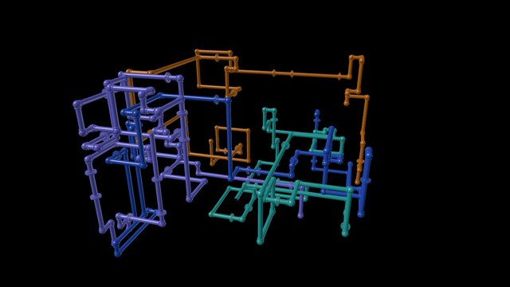
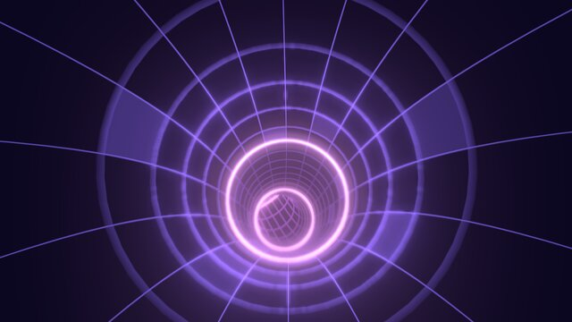
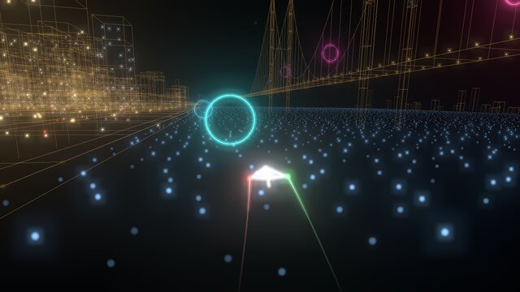
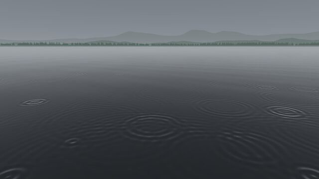
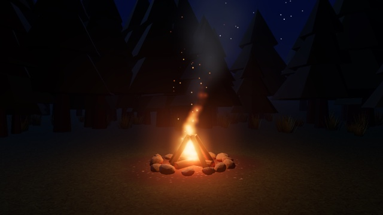
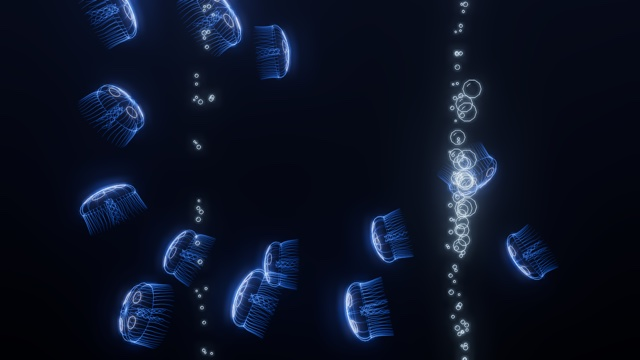
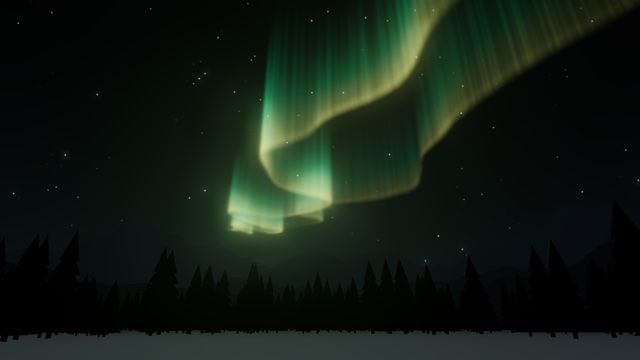

# vibe-screensaver — Web スクリーンセーバ集

Webブラウザで動く、スクリーンセーバ風のアニメーション集です。

**▶ ブラウザですぐに見る: https://yohhoy.github.io/vibe-screensaver/**

## 動かし方

上の URL を開くか、手元で [index.html](index.html) をブラウザで開きます。WebGL2 対応のブラウザとインターネット接続が必要です。

各作品の「シーン切替」は、暗転して次の場面へ移る操作です。Space キー（スマホでは左右スワイプ）で行います。
「強度」（速度・雨の強さなど）は ↑ / ↓ キー（スマホでは上下スワイプ。上へで強く）で変えられます。変えたときは、画面の右端に細いゲージが少しの間だけ表示されます。

スマホでも表示できます。スマホでは、表示している間は画面が自動で消えないようにしています（対応ブラウザのみ）。

## [3D パイプ](https://yohhoy.github.io/vibe-screensaver/pipes.html)

3D 空間に、色とりどりのパイプが自動で伸びていきます。

| キー | 動作 |
|---|---|
| Space / 左右スワイプ | シーン切替（リセット） |
| F / ダブルクリック | 全画面 |
| J | ジョイントを球 ⇔ エルボーで切り替え |
| ↑ / ↓ / 上下スワイプ | 速度の変更 |

## [チューブトンネル](https://yohhoy.github.io/vibe-screensaver/tube.html)

ネオングリッドのチューブの中を、どこまでも飛び続けます。

| キー | 動作 |
|---|---|
| Space / 左右スワイプ | シーン切替（新しいコースと配色） |
| F / ダブルクリック | 全画面 |
| ↑ / ↓ / 上下スワイプ | 速度の変更 |

隠し要素（ネタバレ注意）

ときどき壁のハッチから Claude Code のマスコットが跳び出してきます。**C** キーですぐに呼び出せます。

## [ナイトドローン](https://yohhoy.github.io/vibe-screensaver/drone.html)

夜の街を、紙飛行機形のドローンが輪をくぐりながら飛び続けます。

| キー | 動作 |
|---|---|
| Space / 左右スワイプ | シーン切替（次のコース） |
| F / ダブルクリック | 全画面 |
| ↑ / ↓ / 上下スワイプ | 速度の変更 |

## [雨の水面](https://yohhoy.github.io/vibe-screensaver/ripple.html)

静かな水面に雨が降り、波紋がゆるやかに広がっては消えていきます。

| キー | 動作 |
|---|---|
| Space / 左右スワイプ | シーン切替（次の景色） |
| F / ダブルクリック | 全画面 |
| ↑ / ↓ / 上下スワイプ | 雨の強さの変更 |

隠し要素（ネタバレ注意）

景色ごとに、ときどき出来事が起こります。夜の湖面では流れ星が流れ、街あかりでは UFO が現れ、霧雨の朝では魚が跳ねます。**C** キーで、いまの景色の出来事をすぐに起こせます。

## [焚き火](https://yohhoy.github.io/vibe-screensaver/campfire.html)

夜の森の焚き火。炎が揺らぎ、火の粉が星空へ舞い上がります。

| キー | 動作 |
|---|---|
| F / ダブルクリック | 全画面 |
| ↑ / ↓ / 上下スワイプ | 火の強さの変更 |

## [クラゲ水槽](https://yohhoy.github.io/vibe-screensaver/jellyfish.html)

薄暗い水族館の大きな水槽。光る線で描いたクラゲが水流に乗ってゆっくり回り、立ちのぼる泡に触れると傾いたりひっくり返ったりします。クラゲの色は虹色にゆっくり移り変わります。

| キー | 動作 |
|---|---|
| Space / 左右スワイプ | シーン切替（クラゲの形・色などを選び直す） |
| F / ダブルクリック | 全画面 |
| ↑ / ↓ / 上下スワイプ | 立ちのぼる泡の筋の数の変更 |

## [オーロラ](https://yohhoy.github.io/vibe-screensaver/aurora.html)

山あいの谷から見上げる北の空に、オーロラのカーテンが揺らめきます。ときどき急に明るく激しくなります。

| キー | 動作 |
|---|---|
| Space / 左右スワイプ | シーン切替（リセット） |
| F / ダブルクリック | 全画面 |
| ↑ / ↓ / 上下スワイプ | オーロラの帯の数の変更 |

隠し要素（ネタバレ注意）

ときどきサンタクロースのシルエットが空を横切ります。**C** キーですぐに呼び出せます。

## 開発者向け情報

実装の方針は [DEVELOPMENT.md](DEVELOPMENT.md)、作品ごとの仕様は [docs/](docs/) を参照してください。調整用の定数は、各 HTML ファイル冒頭の「設定」節にあります。

## ライセンス

[MIT License](LICENSE)
