# vibe-screensaver — Web スクリーンセーバ集

Webブラウザで動く、スクリーンセーバ風のアニメーション集です。

**▶ ブラウザですぐに見る: https://yohhoy.github.io/vibe-screensaver/**

## 動かし方

WebGL2 対応のブラウザとインターネット接続が必要です。スマホでは、表示中は画面が自動で消えません（対応ブラウザのみ）。

共通の操作は次のとおりです。スマホでは、画面をタップすると操作ガイドが表示されます。

- **シーン切替**: Space / 左右スワイプ
- **強度**: ↑ / ↓ / 上下スワイプ
- **全画面**: F / ダブルクリック
- **作品一覧へ戻る**: Esc / 「← 一覧」

## [3D パイプ](https://yohhoy.github.io/vibe-screensaver/pipes.html)

[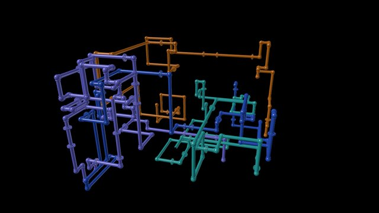](https://yohhoy.github.io/vibe-screensaver/pipes.html)

3D のグリッドの中を、色とりどりのパイプが自動で伸びていきます。画面が埋まると暗転して、最初から伸び直します。

シーン切替: リセット / 強度: 速度 / J: ジョイントを球 ⇔ エルボーで切り替え

## [チューブトンネル](https://yohhoy.github.io/vibe-screensaver/tube.html)

[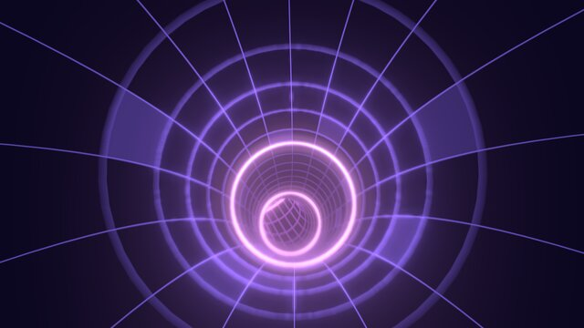](https://yohhoy.github.io/vibe-screensaver/tube.html)

ネオングリッドのチューブの中を、曲がりくねった輪っか状のコースに沿ってどこまでも飛び続けます。壁には光のリングとパルスが流れます。

シーン切替: 新しいコースと配色 / 強度: 速度

隠し要素（ネタバレ注意）

ときどき壁のハッチから Claude Code のマスコットが跳び出してきます。**C** キーですぐに呼び出せます。

## [ナイトドローン](https://yohhoy.github.io/vibe-screensaver/drone.html)

[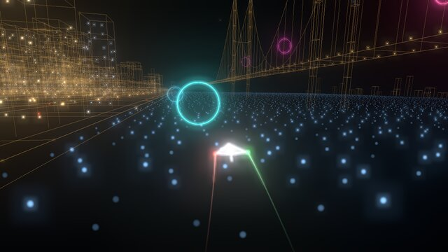](https://yohhoy.github.io/vibe-screensaver/drone.html)

ワイヤーフレームと点群で描いた夜の街を、紙飛行機形のドローンが輪をくぐりながら飛び続けます。大通り、港、電波塔の 3 つのコースがあります。

シーン切替: 次のコース / 強度: 速度

## [雨の水面](https://yohhoy.github.io/vibe-screensaver/ripple.html)

[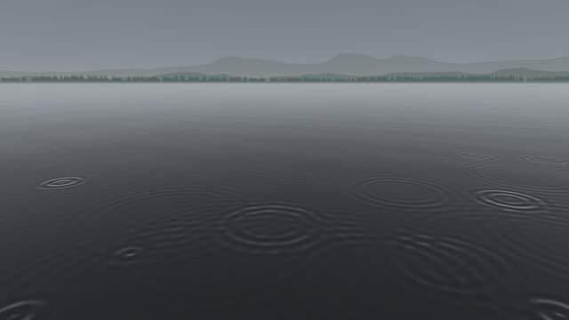](https://yohhoy.github.io/vibe-screensaver/ripple.html)

静かな水面に雨が降り、波紋が空や明かりの映り込みを揺らします。月夜、街、霧の 3 つの景色があります。

シーン切替: 次の景色 / 強度: 雨の強さ

隠し要素（ネタバレ注意）

景色ごとに、ときどき出来事が起こります。月夜では流れ星が流れ、街では UFO が現れ、霧では魚が跳ねます。**C** キーで、いまの景色の出来事をすぐに起こせます。

## [焚き火](https://yohhoy.github.io/vibe-screensaver/campfire.html)

[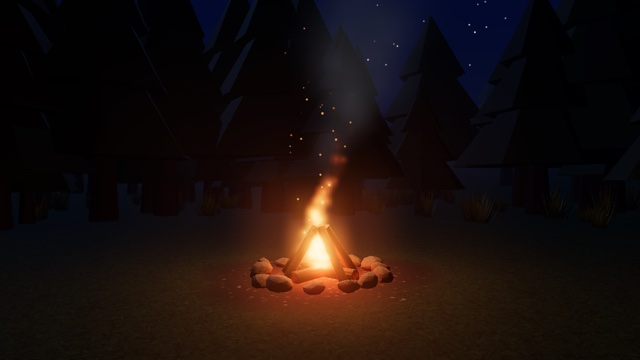](https://yohhoy.github.io/vibe-screensaver/campfire.html)

夜の森の空き地の焚き火。炎が揺らぎ、火の粉が星空へ舞い上がります。

シーン切替: なし / 強度: 火の強さ

隠し要素（ネタバレ注意）

ときどきリスが走ってきて、どんぐりを焚き火に投げ込むと打ち上げ花火が上がります。**C** キーですぐに呼び出せます。

## [クラゲ水槽](https://yohhoy.github.io/vibe-screensaver/jellyfish.html)

[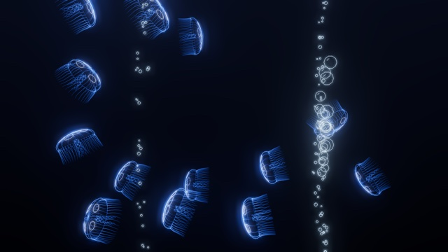](https://yohhoy.github.io/vibe-screensaver/jellyfish.html)

薄暗い水族館の、大きなクラゲ水槽。光る線で描いたクラゲが水流に乗ってゆっくり回り、下から小さな泡が立ちのぼります。

シーン切替: リセット / 強度: 泡の筋の数

## [オーロラ](https://yohhoy.github.io/vibe-screensaver/aurora.html)

[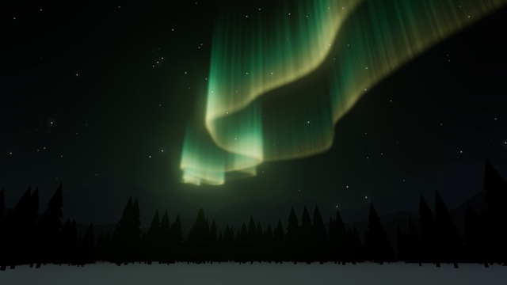](https://yohhoy.github.io/vibe-screensaver/aurora.html)

山あいの谷の上、北の空にオーロラのカーテンが揺らめき、ときどき急に明るく激しくなります。

シーン切替: リセット / 強度: オーロラの帯の数

隠し要素（ネタバレ注意）

ときどきサンタクロースのシルエットが空を横切ります。**C** キーですぐに呼び出せます。

## [滝](https://yohhoy.github.io/vibe-screensaver/waterfall.html)

[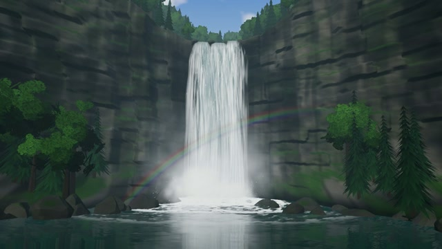](https://yohhoy.github.io/vibe-screensaver/waterfall.html)

深い森の大きな滝。白い水が流れ落ち、滝壺から霧が立ちのぼります。日中、夕暮れ、月夜の 3 つの景色があります。

シーン切替: 次の景色 / 強度: 水量

隠し要素（ネタバレ注意）

ときどき、鯉が滝を登り、そのあと龍が空へ昇ります（登竜門）。**C** キーですぐに呼び出せます。

## [溶岩ランプ](https://yohhoy.github.io/vibe-screensaver/lavalamp.html)

[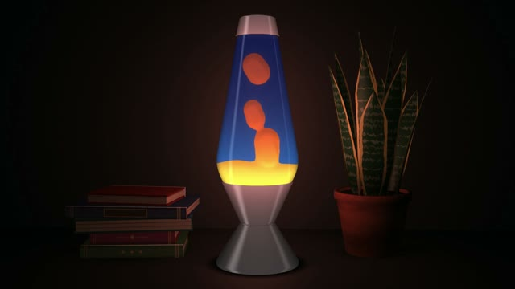](https://yohhoy.github.io/vibe-screensaver/lavalamp.html)

暗い部屋に置かれた溶岩ランプ。色付きの蝋がゆっくり昇り降りし、ちぎれたり融合したりします。

シーン切替: 新しい配色 / 強度: 温度

## [ペンギンの行進](https://yohhoy.github.io/vibe-screensaver/penguins.html)

[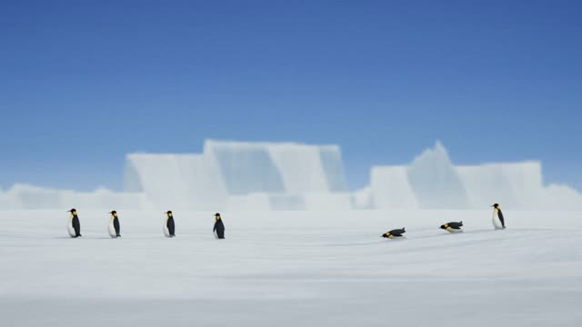](https://yohhoy.github.io/vibe-screensaver/penguins.html)

南極の雪原を、ペンギンの群れが列になって横切っていきます。ときどき腹ばいで滑って列を追い越します。快晴、白夜、吹雪の 3 つの景色があります。

シーン切替: 次の景色 / 強度: ペンギンの数

隠し要素（ネタバレ注意）

ときどき綿毛のヒナが列に加わります。**C** キーですぐに呼び出せます。

## [ダイヤモンドの展示室](https://yohhoy.github.io/vibe-screensaver/diamond.html)

[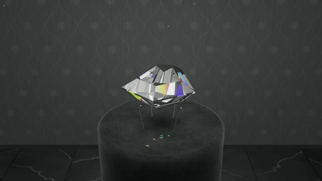](https://yohhoy.github.io/vibe-screensaver/diamond.html)

閉館後の美術館で、台座に乗った大きなダイヤモンドがひとつだけ展示されています。ゆっくり回りながらきらめき、カットは毎回ランダムに作られます。

シーン切替: 新しいカット / 強度: 回転の速さ

隠し要素（ネタバレ注意）

ときどき天井から蜘蛛が降りてきます。**C** キーですぐに呼び出せます。

## [サンドピクチャー](https://yohhoy.github.io/vibe-screensaver/sandpicture.html)

[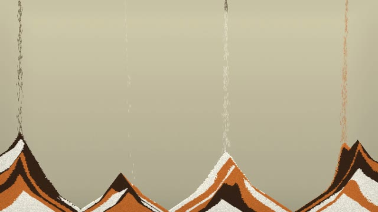](https://yohhoy.github.io/vibe-screensaver/sandpicture.html)

サンドピクチャーの中で、色砂が細い筋になって降り積もり、地層のような山並みを描きます。積もりきると次の絵に移ります。

シーン切替: 次の絵 / 強度: 砂の落ちてくる口の数

隠し要素（ネタバレ注意）

ときどき、ふたこぶラクダが砂の山を越えて画面を横切ります。**C** キーですぐに呼び出せます。

## [無限の和室](https://yohhoy.github.io/vibe-screensaver/infcastle.html)

[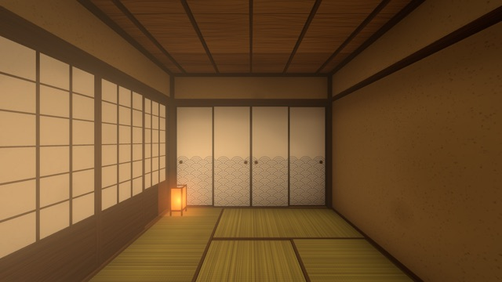](https://yohhoy.github.io/vibe-screensaver/infcastle.html)

人の気配のない仄暗い和室を歩き続けます。襖や障子が開くと、その先にまた別の和室があり、どこまでも終わりません。

> ⚠️ **3D 酔いにご注意ください。** 一人称視点で歩き続け、視点が大きく回る場面があります。

シーン切替: 別の部屋へ飛ぶ / 強度: 歩く速さ

隠し要素（ネタバレ注意）

ときどき、行き止まりの隠し部屋に行き着きます。**C** キーですぐに呼び出せます。

## [ティーポット](https://yohhoy.github.io/vibe-screensaver/teapot.html)

[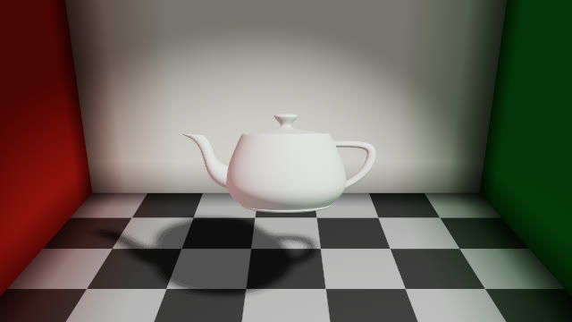](https://yohhoy.github.io/vibe-screensaver/teapot.html)

宙に浮いた Utah Teapot がゆっくり回転します。ワイヤーフレームから物理ベースまで、描き方が CG の歴史の順に移り変わります。

シーン切替: 次の時代 / 強度: 回る速さ

## [シャボン玉](https://yohhoy.github.io/vibe-screensaver/bubbles.html)

[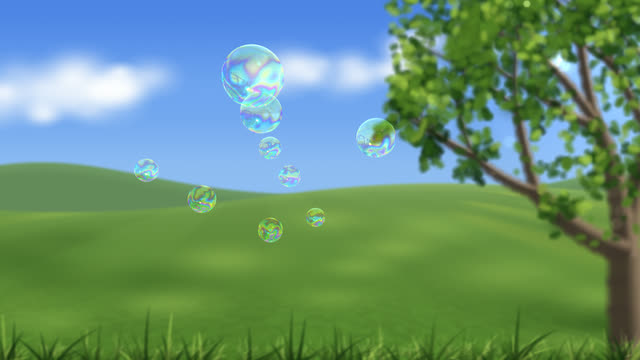](https://yohhoy.github.io/vibe-screensaver/bubbles.html)

風に乗って、シャボン玉がすぐ近くを流れていきます。虹色の膜がゆらめき、やがてはじけて消えます。草原、海辺、臨海エリアの 3 つの景色があります。

シーン切替: 次の景色 / 強度: 吹く頻度

隠し要素（ネタバレ注意）

ときどき、巨大なハート形のシャボン玉が流れてきます。**C** キーですぐに呼び出せます。

## [太陽系儀](https://yohhoy.github.io/vibe-screensaver/orrery.html)

[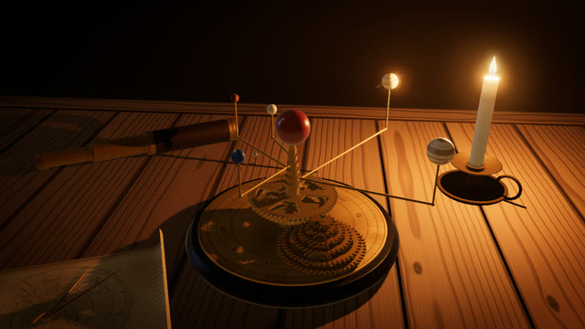](https://yohhoy.github.io/vibe-screensaver/orrery.html)

仄暗い書斎。古い木の机の上で、真鍮の太陽系儀が歯車に回され、惑星がゆっくり巡ります。机の上の明かりで、腕や惑星の影が机の上をゆっくり動きます。同じオーラリーが受け継がれ、明かりと道具だけが時代とともに替わります。

シーン切替: 次の時代 / 強度: 公転の速さ

隠し要素（ネタバレ注意）

ときどき遠くから彗星が飛んできて、太陽のすぐそばを回り込みます。**C** キーですぐに呼び出せます。

## [箱庭の街](https://yohhoy.github.io/vibe-screensaver/pixelcity.html)

[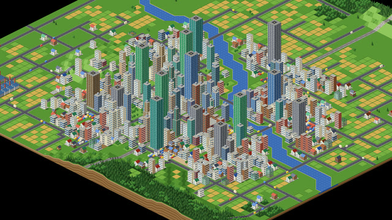](https://yohhoy.github.io/vibe-screensaver/pixelcity.html)

懐かしいドット絵の箱庭で、何も無い土地が、家、鉄道、自動車の時代を経てビルの街へ育っていきます。育ちきると、季節を変えて新しい土地でやり直します。

シーン切替: 新しい土地 / 強度: 成長の速さ

## [ビー玉の段々道](https://yohhoy.github.io/vibe-screensaver/marbles.html)

[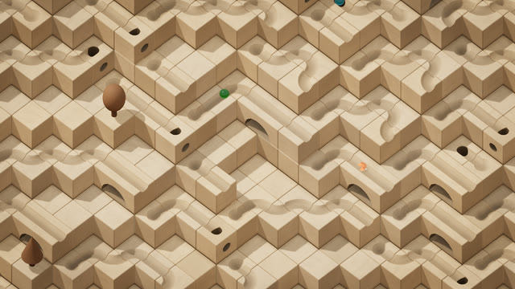](https://yohhoy.github.io/vibe-screensaver/marbles.html)

溝が彫られた様々な素材の積み木が、手前へ段々に下がりながら続きます。ビー玉が溝を転がり、段差から飛び降り、穴をくぐって、1 段ずつ下っていきます。

シーン切替: 次の材質 / 強度: ビー玉の数

隠し要素（ネタバレ注意）

ときどき、積み木の上に、積み木と同じ材質で作った Claude Code のマスコットが置かれています。**C** キーですぐに呼び出せます。

## [巡る水路](https://yohhoy.github.io/vibe-screensaver/flume.html)

[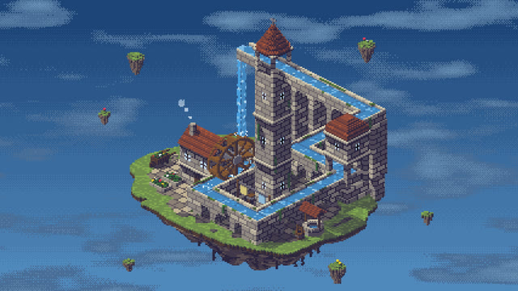](https://yohhoy.github.io/vibe-screensaver/flume.html)

荒いドット絵で描いた、空に浮かぶ小さな石造りの浮島。水路を流れていった水が、なぜか水車の真上に戻ってきて水車を回し続けます。庭、粉ひき場、廃墟の 3 つの景色があります。

シーン切替: 次の場面 / 強度: 水量

隠し要素（ネタバレ注意）

ときどき黄色いアヒルのおもちゃが水路を流れてきて、浮島をひと巡りします。**C** キーですぐに呼び出せます。

## [六角ネットワーク](https://yohhoy.github.io/vibe-screensaver/hexnet.html)

[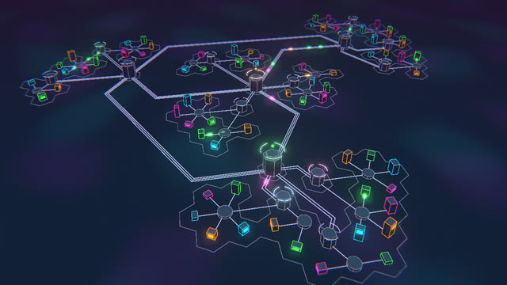](https://yohhoy.github.io/vibe-screensaver/hexnet.html)

暗い海の上に浮かぶ、六角セルでできたネットワークの群島。ケーブルが伸びた先にルータが立ち、ホストが並んで、島が 1 つずつ育っていきます。サービスごとの色のパケットがルータを経由して島をまたいで行き交い、ときどきリンクが切れると、迂回路へ流れを変えます。

シーン切替: 新しい群島 / 強度: パケットの量

隠し要素（ネタバレ注意）

ときどき群島のあちこちのホストが乗っ取られ、1 台のホストへいっせいにパケットを撃ち込む DDoS 攻撃が起こります。**C** キーですぐに呼び出せます。

## 開発者向け情報

実装の方針は [DEVELOPMENT.md](DEVELOPMENT.md)、作品ごとの仕様は [docs/specs/](docs/specs/) を参照してください。調整用の定数は、各 HTML ファイル冒頭の「設定」節にあります。

## ライセンス

[MIT License](LICENSE)
